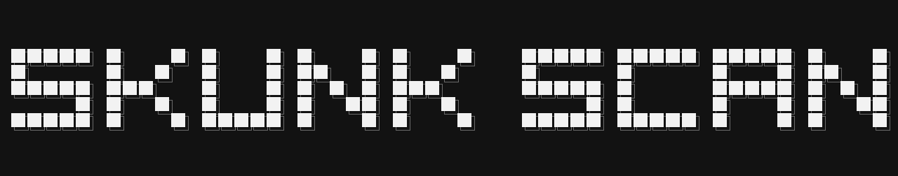
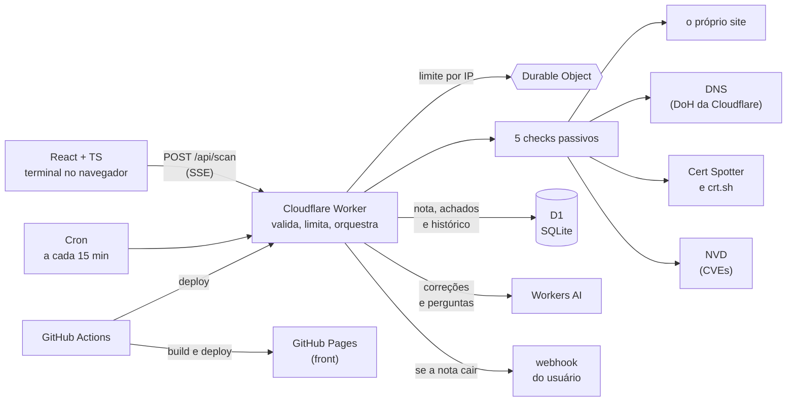
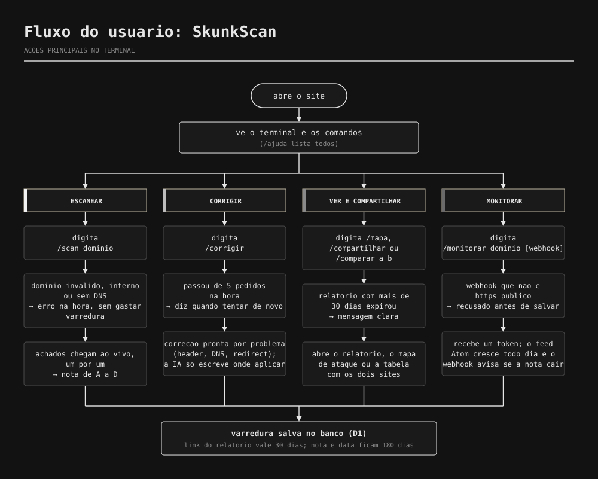
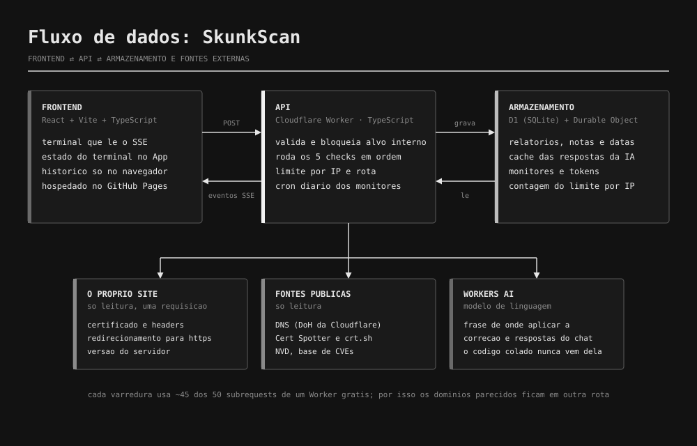

<p align="center">
  
</p>

<p align="center">
  <a href="https://github.com/Pedroaruana/Skunk-Scan/actions/workflows/ci.yml"></a>
  
  
  
  
  
  
  <a href="LICENSE"></a>
</p>

O SkunkScan é uma ferramenta que eu fiz para o dono de uma pequena empresa descobrir, em menos de um minuto e sem instalar nada, o quanto o site dele está exposto. Eu digito `/scan seusite.com.br` num terminal que roda dentro do navegador, e ele me devolve uma nota de A a D, os problemas separados por gravidade e a correção pronta para cada um.

A análise é 100% passiva. Eu só leio o que o próprio site já deixa público (certificado, headers, DNS, registros públicos de certificados). Não faço varredura de portas, não tento login e não mando nenhum payload.

**Site no ar:** https://pedroaruana.github.io/Skunk-Scan/
**API:** https://skunkscan-api.aruanapedro.workers.dev

Projeto do time Crypto Skunks para o Hack Brasil 2026, trilha Cibersegurança.

---

## Por que eu fiz isso

Pequena empresa quase nunca tem alguém olhando segurança. O site foi feito por uma agência, o e-mail é do domínio da empresa, e ninguém sabe se o certificado vence na semana que vem, se o DMARC existe ou se aquele `staging.` esquecido ainda responde na internet. As ferramentas que mostram isso são pagas ou feitas para quem já entende do assunto.

Eu quis o oposto: um comando só, resposta em linguagem que dá para mandar para o dono do negócio, e uma correção que dá para copiar e colar. O terminal é a interface porque eu queria que fosse rápido e que desse vontade de explorar.

## O que ele verifica

| Check | O que eu olho | De onde vem |
|---|---|---|
| TLS e headers | certificado, redirect de http para https, HSTS, CSP, nosniff, proteção contra iframe, versão do servidor exposta | uma requisição ao próprio site |
| E-mail | SPF, DKIM (seletores comuns) e DMARC | DNS público |
| Subdomínios | `dev.`, `staging.`, `admin.` e outros publicados em certificados, e se ainda resolvem | Certificate Transparency |
| CVEs | falhas conhecidas da versão que o servidor mostra | base NVD |
| Domínios parecidos | variações com letra trocada, hífen e outro final, e quais já foram registradas | DNS |

### Como a nota é calculada

| Nota | Regra |
|---|---|
| A | nenhum problema grave e no máximo 1 médio |
| B | nenhum grave e até 3 médios |
| C | 1 grave, ou mais de 3 médios |
| D | 2 ou mais graves, ou HTTPS quebrado |

Se o site não responde, eu não dou nota. Prefiro não avaliar a dar uma nota enganosa.

## O que dá para fazer

No terminal do site (digite `/ajuda` para ver todos):

| Comando | O que faz |
|---|---|
| `/scan dominio` | varredura completa, com os achados chegando ao vivo |
| `/corrigir` | correção pronta para cada problema (header, registro DNS, redirect) |
| `/perguntar ...` | tira dúvida com a IA, usando o resultado do seu site como contexto |
| `/mapa` | grafo da superfície de ataque: subdomínios, servidor, CVEs e riscos |
| `/comparar a b` | escaneia dois sites e compara os achados lado a lado |
| `/evolucao` | gráfico da nota do site ao longo do tempo |
| `/compartilhar` e `/relatorio` | página pública do resultado (30 dias) e PDF |
| `/monitorar dominio [webhook]` | confere todo dia, mantém um feed Atom e avisa o webhook se a nota cair |
| `/selo dominio` | selo "verificado" em SVG, só para quem está com nota A |

No CI, com a Action do GitHub, o job falha se a nota ficar abaixo da mínima:

```yaml
- uses: Pedroaruana/Skunk-Scan@main
  with:
    domain: meusite.com.br
    min-grade: B
```

A API HTTP está documentada dentro do próprio site, na tela `/docs`.

---

## Arquitetura



### Fluxo do usuário

<p align="center">
  
</p>

### Fluxo de dados

<p align="center">
  
</p>

---

## Decisões técnicas

**Cloudflare Workers com SSE, em vez de um servidor tradicional.** Eu queria que cada checagem aparecesse no terminal assim que terminasse, então a varredura responde em `text/event-stream` (eventos `start`, `step`, `finding`, `warn`, `done`). O Worker roda na borda, é gratuito no volume que eu preciso e não exige manter servidor. Não usei Docker porque nada aqui precisa de container: o back é um Worker e o front é estático.

**Passivo de verdade, e protegido contra SSRF.** Como o serviço faz requisições para o domínio que a pessoa digita, ele é um alvo natural de abuso. Antes de qualquer requisição eu resolvo o domínio por DNS-over-HTTPS e recuso tudo que aponta para IP interno, `localhost` ou sufixo reservado. Os redirects eu sigo na mão, no máximo 3 saltos, e revalido cada destino contra a mesma regra. Se um site redireciona para um endereço interno, a varredura para ali.

**A IA escreve o texto, nunca o código.** O que a pessoa copia e cola (header, registro DNS, bloco de redirect) sai de modelos fixos, preenchidos com o domínio. A IA só escreve uma frase dizendo onde aplicar cada correção, e responde as perguntas do chat. Assim ela não tem como inventar uma configuração errada. As respostas ficam em cache por 7 dias no D1, guardadas por um hash da pergunta (o texto da pergunta não é guardado), e se a IA falha o sistema responde por palavra-chave. Nada quebra quando ela cai.

**D1 e um link imprevisível como único acesso.** O relatório completo fica acessível só por quem tem o link, um código aleatório de 12 caracteres hexadecimais. O conteúdo expira em 30 dias. A nota e a data ficam por 180 dias, só para o gráfico de evolução, e o endpoint público de histórico nunca devolve achados nem o id do relatório.

**Limite por IP com Durable Object.** O limite de 5 varreduras por hora precisava de uma janela de uma hora, e o rate limit nativo do Workers só aceita janelas de 10 ou 60 segundos. Então eu escrevi uma janela deslizante num Durable Object, uma instância por rota e IP, que se limpa sozinha quando a janela vence. Se o limitador falha, ele deixa passar: o limite protege o serviço, não pode derrubá-lo.

**Monitoramento sem e-mail.** Eu não tenho domínio próprio nem conta paga de e-mail transacional. Em vez disso o monitor mantém um feed Atom por domínio e manda um POST para um webhook (serve para Slack e Discord) quando a nota cai. O webhook só aceita HTTPS com nome público, e o destino é conferido de novo na hora do envio.

---

## Desafios que eu enfrentei

**O limite de 50 subrequests do Worker gratuito.** Uma varredura completa faz cerca de 43 consultas externas. Os domínios parecidos, que fazem uma consulta DNS por variação, estouravam o teto junto com o resto. A solução foi tirá-los da rota principal e rodá-los numa segunda chamada, e limitar cada check (28 variações, 8 detalhadas, 20 subdomínios resolvidos, 3 produtos para CVE). O monitor diário tem o mesmo problema, então cada disparo do cron trata um único monitor.

**Fonte de subdomínios instável.** O `crt.sh` às vezes leva mais de 20 segundos ou cai. Passei a consultar primeiro o Cert Spotter, que é rápido, e deixar o `crt.sh` só como reserva, com timeout curto. Ainda assim, quando as duas falham, a varredura segue e avisa que a checagem falhou, em vez de travar.

**Falso positivo de CVE.** Distribuições como Debian e Ubuntu aplicam correções de segurança sem mudar o número da versão, então "nginx 1.18.0" pode estar corrigido. Eu só marco um CVE como grave quando ele está no catálogo da CISA de falhas exploradas na prática e tem CVSS crítico. O resto vira médio, com um aviso de que pode ser falso positivo.

**A IA parou de funcionar em produção sem dar erro.** O Workers AI descontinuou o modelo que eu usava e toda chamada passou a falhar em silêncio, caindo no plano B. O terminal parecia normal. Só descobri lendo os logs do Worker com `wrangler tail`, que mostraram a mensagem de modelo descontinuado. Troquei de modelo, e o novo respondia num formato diferente, então também ajustei o parser e passei a mandar mensagens em vez de um prompt solto. A lição foi manter o plano B, mas deixar a falha visível.

**Publicar no GitHub Pages.** O deploy falhava com "Found 0 artifacts" mesmo com o arquivo enviado: o GitHub demora um instante para listar o que acabou de ser enviado. Separei montar e publicar em dois jobs, que é o formato da documentação do Pages.

**Celular.** O título em pixels quebrava a palavra no meio, o radar passava da largura da tela e o mapa cortava os nós das bordas. Corrigi um a um testando numa tela de 375px.

---

## Segurança e privacidade

- Só leitura de informação pública. Sem varredura de portas, sem login, sem payload.
- Bloqueio de `localhost`, IPs internos e redirects para endereço interno.
- Limite por IP e por rota, com `Retry-After` quando estoura.
- O relatório só abre por link, e expira em 30 dias.
- Sem conta, sem cookies de rastreamento. O histórico das suas varreduras fica só no seu navegador. As métricas de visita, quando ligadas, usam o Cloudflare Web Analytics, que não usa cookies, e o script não carrega para quem usa Do Not Track.
- Termos de uso, política de privacidade e de cookies estão no próprio site.

## Rodando localmente

Precisa de Node 22 ou mais novo.

```bash
# API (Worker local com D1)
cd api
npm ci
npm run db:local     # cria o banco local e aplica as migrations
npm run dev          # http://localhost:8787

# Front
cd web
npm ci
npm run dev          # aponta para a API local automaticamente
```

O `/corrigir` e o `/perguntar` usam o Workers AI, que precisa de login do Wrangler (`npx wrangler login`). Sem isso eles caem no plano B e respondem mesmo assim.

Testes e checagens:

```bash
cd api && npm run typecheck && npm test   # 133 testes
cd web && npm run typecheck && npm test   # 55 testes
cd web && npm run build
```

## CI e deploy

- **CI** (`ci.yml`): em todo pull request roda tipos e testes da API, tipos, testes e build do front, e aplica as migrations num banco local vazio, para um SQL quebrado falhar aqui e não no deploy.
- **Deploy da API** (`deploy-api.yml`): quando algo em `api/` muda na `main`, roda os testes, aplica as migrations no D1 e publica o Worker.
- **Deploy do site** (`deploy-web.yml`): quando algo em `web/` muda, faz o build e publica no GitHub Pages.
- **Autoscan** (`selfscan.yml`): todo dia escaneia o próprio site com a Action.

Os dois deploys são separados de propósito: uma mudança só no site não republica o Worker. Sem os secrets `CLOUDFLARE_API_TOKEN` e `CLOUDFLARE_ACCOUNT_ID`, o deploy da API é pulado com um aviso em vez de falhar.

## Estrutura do repositório

```
api/                  Worker (TypeScript)
  src/checks/         os 5 checks passivos
  src/                rotas, SSRF, nota, relatórios, IA, selo, monitor, feed
  migrations/         esquema do D1
  test/               testes com Vitest
web/                  front (React + Vite + TypeScript + Tailwind)
  src/terminal/       motor do terminal e todos os comandos
  src/views/          home, resultado, radar, mapa, como funciona, docs
  src/lib/            lógica sem tela (API, gráfico, grafo do mapa, rotas)
action.yml            Action do GitHub (autoscan)
action/autoscan.sh    script que a Action executa
docs/                 banner e diagramas (e os scripts que geram os SVGs)
.github/workflows/    CI, deploys e autoscan
```

## Limitações e o que eu faria depois

- **O Radar Brasil mostra dados de exemplo.** Está marcado na tela. Os números reais dependem de uma base grande de varreduras anônimas que eu ainda não tenho.
- **O selo não prova que quem o usa é dono do domínio.** Qualquer pessoa pode escanear um site. Eu deixei isso escrito nos termos. O passo seguinte seria uma verificação de posse, por exemplo um registro TXT.
- **DKIM só testa seletores comuns.** Se o seletor tiver outro nome, o achado vira "não confirmado" e não "ausente".
- **O plano gratuito limita.** Máximo de 50 monitores ao mesmo tempo e uma varredura por execução do cron.
- **Eu ainda não tenho a CLI** que a primeira ideia previa. A Action cobre o caso de uso de CI.

## Time e licença

Feito pelo time **Crypto Skunks** para o Hack Brasil 2026. Licença [MIT](LICENSE).
